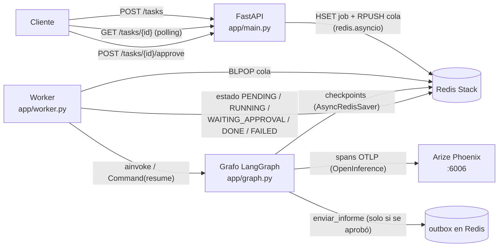
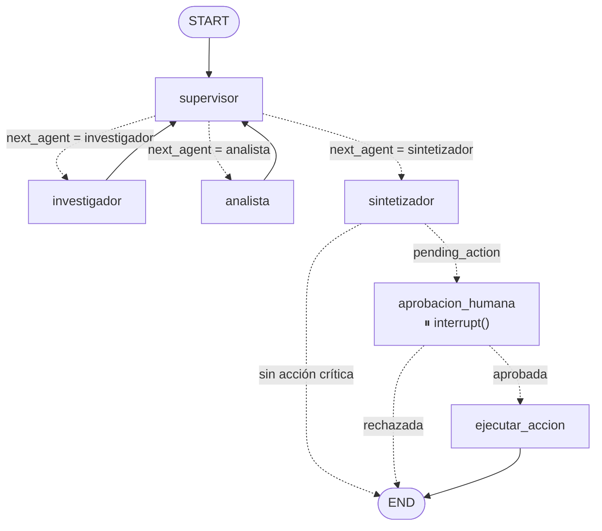
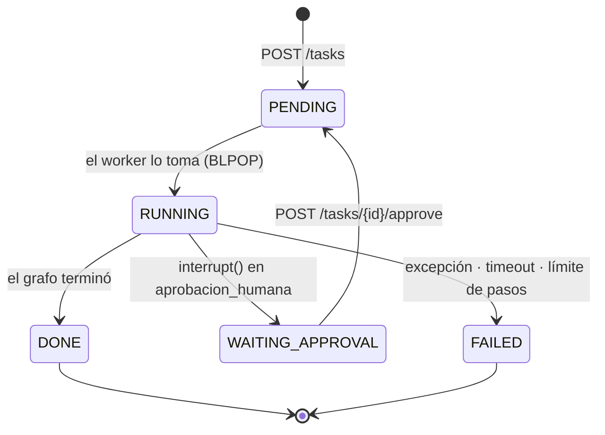
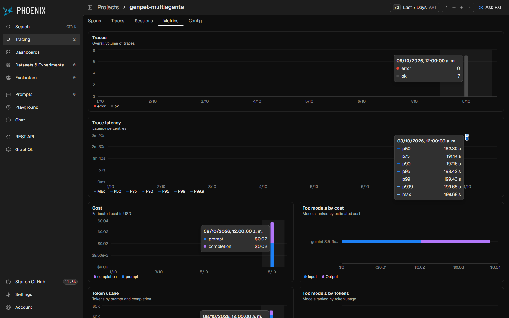
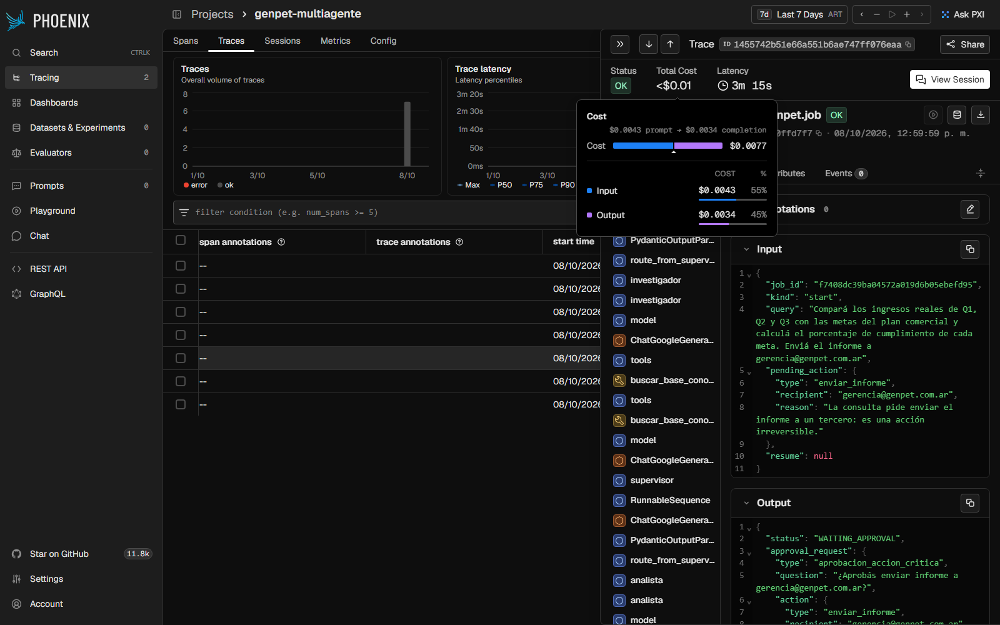

# Pre-entrega 7: API de producción y monitoreo activo

API REST **asíncrona** (FastAPI) que expone el **orquestador multi-agente de la Pre-entrega 6** (supervisor +
investigador + analista + sintetizador sobre los datos de **GenPet**) con:

- **Cola de trabajo y estado de los jobs en Redis**: `POST /tasks` encola y devuelve un `job_id` en milisegundos; el
  grafo corre en un **worker** (dentro de la API o como proceso aparte).
- **Checkpoints de LangGraph en Redis** (`AsyncRedisSaver`): el estado completo del grafo sobrevive a pausas,
  reinicios y cambios de worker.
- **Observabilidad con Arize Phoenix** (OpenTelemetry + OpenInference): una traza por ejecución con cada nodo, cada
  llamada al LLM (tokens y costo) y cada tool call.
- **Human-in-the-loop**: las tareas que piden una acción irreversible (enviar el informe a un tercero) se **detienen**
  con `interrupt()` hasta que un humano las aprueba o rechaza con `POST /tasks/{id}/approve`.
- **Prueba de carga** de 5 peticiones concurrentes con **costo por ejecución** y **latencia p95** medidos en Phoenix.

La consigna original está en [`CONSIGNA.md`](CONSIGNA.md).

## Contenido

- [Arquitectura](#arquitectura)
- [Cómo se cumple la consigna](#cómo-se-cumple-la-consigna)
- [Cómo ejecutarlo](#cómo-ejecutarlo)
- [API](#api)
- [Ciclo de vida de un job y manejo de errores](#ciclo-de-vida-de-un-job-y-manejo-de-errores)
- [Human-in-the-loop](#human-in-the-loop)
- [Persistencia en Redis](#persistencia-en-redis)
- [Observabilidad](#observabilidad)
- [Prueba de carga y evidencia de costos](#prueba-de-carga-y-evidencia-de-costos)
- [Lectura del dashboard](#lectura-del-dashboard)
- [Decisiones y limitaciones](#decisiones-y-limitaciones)
- [Estructura del proyecto](#estructura-del-proyecto)
- [Tests](#tests)

## Arquitectura



- La **API nunca ejecuta el grafo**: valida, clasifica la tarea, escribe el job y lo encola en una sola transacción
  de Redis. Todas las operaciones son `async` (cliente `redis.asyncio`), así que el event loop no se bloquea.
- El **worker** tiene `WORKER_CONCURRENCY` corrutinas consumidoras (5 por defecto) que hacen `BLPOP` sobre la cola.
  Como la cola vive en Redis, el worker puede correr **dentro de la API** (`RUN_WORKER_IN_API=true`) o **en otro
  proceso/contenedor** (`python -m app.worker`, que es como lo levanta el `docker-compose.yml`).
- La cola transporta dos tipos de mensajes: `start` (correr el grafo desde cero) y `resume` (reanudar un grafo
  pausado con la decisión humana). Ambos los procesa el mismo worker con `thread_id = job_id`.

### Grafo

Es el orquestador de la Pre-entrega 6 (topología jerárquica con guardas contra el "supervisor infinito", validación
de grounding y resolución de conflictos) con dos nodos nuevos después de la síntesis. Exportado con
`python scripts/export_diagram.py` → [`docs/graph.mmd`](docs/graph.mmd) / [`docs/graph.png`](docs/graph.png):



## Cómo se cumple la consigna

| Requisito (rúbrica) | Implementación | Archivo |
|---|---|---|
| **Endpoint asíncrono que encola y devuelve `job_id`** (30%) | `POST /tasks` responde `202` con `job_id` en ~10 ms: guarda el job y hace `RPUSH` en una transacción de Redis. `GET /tasks/{id}` es una lectura de Redis. Todo con `redis.asyncio` y el grafo con `ainvoke` (nada síncrono en el event loop) | [`app/main.py`](app/main.py), [`app/jobs.py`](app/jobs.py) |
| **Patrón Worker** | N corrutinas consumidoras con `BLPOP`; corre en la API o como proceso separado (`python -m app.worker`, servicio `worker` del compose) | [`app/worker.py`](app/worker.py) |
| **Estado del job en Redis + `FAILED` ante una excepción** (25%) | Hash `genpet:job:<id>` con estado, timestamps, resultado y error. Toda excepción del grafo (error del LLM, `GraphRecursionError`), el **timeout** por job y la cancelación del worker terminan en `FAILED` con el motivo | [`app/worker.py`](app/worker.py), [`app/jobs.py`](app/jobs.py) |
| **Checkpoints de LangGraph en Redis** | `AsyncRedisSaver` (`langgraph-checkpoint-redis`) con TTL; `thread_id = job_id` | [`app/graph.py`](app/graph.py) |
| **Trazas visibles en el dashboard** (25%) | Phoenix vía `phoenix.otel.register` + `LangChainInstrumentor`; span raíz `genpet.job` con el decorador `@tracer.chain` de OpenInference; `session.id = job_id` | [`app/observability.py`](app/observability.py), [`screenshots/`](screenshots/) |
| **Costo por ejecución y latencia p95 de 5 peticiones concurrentes** | `scripts/load_test.py` + capturas de Phoenix | [`scripts/load_test.py`](scripts/load_test.py), [`screenshots/03_costo_por_ejecucion.png`](screenshots/03_costo_por_ejecucion.png), [`screenshots/04_latencia_p95.png`](screenshots/04_latencia_p95.png) |
| **Nodo Human-in-the-loop** (15%) | `aprobacion_humana` llama a `interrupt()`; el job queda en `WAITING_APPROVAL` hasta `POST /tasks/{id}/approve`, que encola `Command(resume=...)` | [`app/hitl.py`](app/hitl.py) |
| **README, requirements y Docker Compose** (5%) | Este archivo, [`requirements.txt`](requirements.txt) (versiones fijadas), [`docker-compose.yml`](docker-compose.yml) con Redis Stack + Phoenix + API + worker | — |

## Cómo ejecutarlo

Requisitos: **Python 3.12+** y **Docker** (para Redis Stack y Phoenix).

### 1. Entorno virtual e instalación

```bash
python -m venv .venv
# Windows (PowerShell)
.\.venv\Scripts\Activate.ps1
# Linux / macOS
source .venv/bin/activate

pip install -r requirements.txt
```

### 2. Variables de entorno

```bash
cp .env.example .env
```

| Variable | Descripción |
|---|---|
| `LLM_PROVIDER` | `openai`, `anthropic`, `gemini` u `openrouter` |
| `LLM_MODEL` | Modelo (opcional; si no, el default del provider en [`app/config.py`](app/config.py)) |
| `OPENAI_API_KEY` / `ANTHROPIC_API_KEY` / `GEMINI_API_KEY` / `OPENROUTER_API_KEY` | Solo hace falta la del provider elegido |
| `LLM_MAX_TOKENS` | Tope de tokens de salida por llamada |
| `LLM_REQUESTS_PER_MINUTE` | Opcional: rate limiter compartido por todos los jobs (ej. `14` para el free tier de Gemini) |
| `TAVILY_API_KEY` | Opcional: búsqueda web para el investigador |
| `REDIS_URL` | `redis://localhost:6379/0` (Redis Stack: el checkpointer necesita RedisJSON + RediSearch) |
| `RUN_WORKER_IN_API` | `true`: el worker corre dentro de la API. `false`: correrlo aparte con `python -m app.worker` |
| `WORKER_CONCURRENCY` | Jobs ejecutándose en paralelo (default 5) |
| `JOB_TIMEOUT_SECONDS` | Tiempo máximo por ejecución; al superarlo el job pasa a `FAILED` |
| `PHOENIX_ENABLED` / `PHOENIX_COLLECTOR_ENDPOINT` / `PHOENIX_PROJECT_NAME` | Exportación de trazas a Phoenix |

### 3. Levantar Redis y Phoenix

```bash
docker compose up -d redis phoenix
```

- Redis Stack queda en `localhost:6379` (con AOF: los jobs y checkpoints sobreviven a un reinicio).
- Phoenix queda en <http://localhost:6006> (UI + colector OTLP en `/v1/traces`).

### 4. Levantar la API

```bash
uvicorn app.main:app --port 8000
```

Con `RUN_WORKER_IN_API=true` (default) el worker arranca dentro de la API. Para correrlo como **proceso separado**:

```bash
# terminal 1 (en .env: RUN_WORKER_IN_API="false")
uvicorn app.main:app --port 8000
# terminal 2
python -m app.worker
```

Documentación interactiva (Swagger): <http://localhost:8000/docs>.

**Alternativa — todo en Docker** (API y worker en contenedores separados, leen las keys de `.env`):

```bash
docker compose up -d --build
```

### 5. Lanzar las 5 peticiones concurrentes

```bash
python scripts/load_test.py              # 5 consultas distintas en paralelo; 2 son críticas y se aprueban
python scripts/load_test.py --reject     # el "humano" rechaza: verifica que no se envíe nada (results/load_test_reject.json)
python scripts/load_test.py -n 1 --query "¿Cuáles fueron los ingresos netos del Q1?"
```

El script hace los `POST /tasks` a la vez, sigue cada job por polling, **aprueba** los que quedan en
`WAITING_APPROVAL` (actúa como el humano), imprime una tabla con estado, latencia y flujo de cada job, y guarda el
detalle en [`results/load_test.json`](results/load_test.json). Después, el costo y la latencia p95 se leen en
Phoenix: **Projects → genpet-multiagente → Metrics** (gráfico *Trace latency*) y el detalle de cada traza
(**Total Cost**).

## API

| Método | Ruta | Respuesta | Descripción |
|---|---|---|---|
| `POST` | `/tasks` | `202` `{job_id, status, critical, links}` | Clasifica la tarea, la guarda en Redis y la encola. No espera al LLM |
| `GET` | `/tasks/{job_id}` | `200` estado del job / `404` | Estado, resultado, flujo del supervisor, pedido de aprobación o error |
| `POST` | `/tasks/{job_id}/approve` | `202` / `404` / `409` | Aprueba o rechaza la acción crítica; `409` si el job no está esperando aprobación |
| `GET` | `/health` | `200` / `503` | Ping a Redis y modo del worker |

Ejemplo con Python (`httpx`):

```python
import httpx, time

api = httpx.Client(base_url="http://localhost:8000")
job = api.post("/tasks", json={
    "query": "Compará los ingresos reales de Q1 a Q3 con las metas y calculá el cumplimiento",
    "send_report_to": "gerencia@genpet.com.ar",   # opcional: vuelve crítica a la tarea
}).json()

while (estado := api.get(f"/tasks/{job['job_id']}").json())["status"] not in ("DONE", "FAILED"):
    if estado["status"] == "WAITING_APPROVAL":
        print(estado["approval_request"]["draft"])            # el humano revisa el borrador
        api.post(f"/tasks/{job['job_id']}/approve", json={"approved": True, "reviewer": "ana"})
    time.sleep(2)
print(estado["final_answer"], estado["action_result"])
```

Ejemplo de respuesta de `GET /tasks/{id}` terminado:

```json
{
  "job_id": "f7408dc39ba04572a019d6b05ebefd95",
  "status": "DONE",
  "query": "Compará los ingresos reales de Q1, Q2 y Q3 con las metas ... Enviá el informe a gerencia@genpet.com.ar",
  "pending_action": {"type": "enviar_informe", "recipient": "gerencia@genpet.com.ar", "reason": "..."},
  "approval": {"approved": true, "reviewer": "load-test", "comment": "aprobado en la prueba de carga"},
  "action_result": {"executed": true, "type": "enviar_informe", "recipient": "gerencia@genpet.com.ar", "...": "..."},
  "final_answer": "Los ingresos reales de Q1, Q2 y Q3 superaron las metas ... (Cumplimiento: 110,69%) ...",
  "delegations": 2,
  "flow": ["investigador", "analista", "sintetizador"],
  "error": null
}
```

## Ciclo de vida de un job y manejo de errores



Cómo se evitan los dos errores comunes de la consigna:

| Error común | Cómo se evita |
|---|---|
| **Bloquear el event loop** | Los endpoints solo hacen I/O asíncrono contra Redis (`redis.asyncio`). El grafo no corre en el request: corre en el worker con `ainvoke`, y los nodos usan `ainvoke` del LLM. El checkpointer es el `AsyncRedisSaver`. Resultado medido: `POST /tasks` respondió en **9–48 ms** mientras 5 grafos corrían en paralelo |
| **Ignorar errores en background** | `Worker.process` envuelve cada ejecución en `try/except` + `asyncio.wait_for(JOB_TIMEOUT_SECONDS)`: cualquier excepción, el timeout o la cancelación del worker dejan el job en `FAILED` con el tipo y mensaje del error. Si Redis se cae un instante, el consumidor reintenta en vez de morir. El cliente que hace polling siempre ve un estado terminal |

Evidencia real: en el primer intento de la prueba de carga, el free tier de Gemini devolvió `429 RESOURCE_EXHAUSTED`
a dos jobs; ambos quedaron en `FAILED` con el motivo completo
([`screenshots/10_job_failed_redis.png`](screenshots/10_job_failed_redis.png)) en lugar de dejar al cliente
esperando. Eso motivó el rate limiter compartido (ver [Decisiones](#decisiones-y-limitaciones)).

## Human-in-the-loop

**Qué es una tarea crítica.** Una que pide una acción **con efectos secundarios irreversibles**: enviar el informe a un
destinatario. El sistema la detecta en `classify_task` ([`app/hitl.py`](app/hitl.py)):

- si el request trae `send_report_to`, o
- si la consulta contiene un verbo de envío en imperativo/infinitivo (*enviá, mandá, notificá, compartí, remití…*)
  junto a *informe/reporte/resumen/resultado*. Se ignoran sustantivos como "envío" ("¿cuánto cuesta el envío?" no es
  crítica). El destinatario es el email de la consulta o `direccion@genpet.com.ar` por defecto.

**Cómo se pausa.** El job guarda la `pending_action` en el estado inicial del grafo. Después de la síntesis,
`route_after_synthesis` lo manda a `aprobacion_humana`, que llama a `interrupt()` con el borrador del informe, el
destinatario y la pregunta. LangGraph corta la ejecución y deja el checkpoint en Redis; el worker detecta
`snapshot.interrupts` y pone el job en `WAITING_APPROVAL` con ese payload en `approval_request`.

**Cómo se reanuda.** `POST /tasks/{id}/approve` hace un *compare-and-set* (`WATCH/MULTI`) sobre el estado: solo si el
job está en `WAITING_APPROVAL` registra la decisión y encola un `resume`. Dos aprobaciones simultáneas no reanudan el
grafo dos veces (testeado). El worker invoca `Command(resume=decision)` sobre el mismo `thread_id`: el grafo sigue
exactamente desde el checkpoint de Redis, aunque lo retome otro worker o la API se haya reiniciado.

**Qué se ejecuta.** Solo con `approved: true` el grafo pasa a `ejecutar_accion`, que llama a la tool
`enviar_informe` ([`app/orchestrator/tools/report_sender.py`](app/orchestrator/tools/report_sender.py)): deja el
mensaje en la lista `genpet:outbox` de Redis (simula la cola de un servicio de email). Cualquier otra respuesta
(rechazo o payload mal formado) termina el grafo **sin ejecutar nada**. Además, el prompt del sintetizador le prohíbe
afirmar que el informe "fue enviado": el envío es un paso posterior y condicionado.

## Persistencia en Redis

| Clave | Tipo | Contenido |
|---|---|---|
| `genpet:job:<job_id>` | hash (campos JSON) | estado, consulta, timestamps, `pending_action`, `approval_request`, `approval`, `action_result`, `final_answer`, `flow`, `delegations`, `error`. TTL de 7 días |
| `genpet:queue` | lista | mensajes `{"job_id", "kind": "start" \| "resume", "resume": {...}}` (`RPUSH` / `BLPOP`) |
| `genpet:outbox` | lista | informes enviados por la acción crítica aprobada |
| `checkpoint:*`, `checkpoint_write:*` | JSON (RedisJSON) + índices RediSearch | checkpoints de LangGraph (`AsyncRedisSaver`) por `thread_id = job_id`. TTL de 7 días con refresh al leer |

El estado del job (lo que consulta el cliente) y el checkpoint del grafo (lo que necesita LangGraph para reanudar)
están separados a propósito: el polling lee un hash chico y nunca deserializa el estado del grafo.

## Observabilidad

[`app/observability.py`](app/observability.py):

- `init_observability()` registra un `TracerProvider` que exporta por OTLP/HTTP a Phoenix (`batch=True`: el export no
  agrega latencia) e instrumenta LangChain/LangGraph con `LangChainInstrumentor`. Cada nodo del grafo, cada llamada al
  LLM (con modelo y tokens de entrada/salida, de donde **Phoenix calcula el costo**) y cada tool call quedan como
  spans.
- **Decorador de trazas:** el span raíz de cada ejecución es `genpet.job`, creado con el decorador
  `tracer.chain(name="genpet.job")` de OpenInference sobre `Worker._run_graph`; registra como input el job y como
  output el resultado (`DONE` / `WAITING_APPROVAL`).
- `job_context()` (`using_attributes`) etiqueta todos los spans con `session.id = job_id`, metadata y tags: en la
  vista **Sessions** de Phoenix la ejecución inicial y la reanudación después de la aprobación aparecen como una sola
  sesión de 2 turnos.
- El provider **no** se registra como global a propósito: FastAPI 0.14x trae telemetría nativa que usa el provider
  global y mandaba a Phoenix un span por cada `GET` de polling (~70 trazas basura en una sola ejecución de prueba,
  que además distorsionaban el p95 del proyecto).

## Prueba de carga y evidencia de costos

Corrida: `python scripts/load_test.py` contra el stack de Docker Compose (API y worker en contenedores separados,
`WORKER_CONCURRENCY=5`), modelo `gemini-3.5-flash-lite`, 5 consultas distintas lanzadas a la vez; las dos críticas
(#3 y #5) se aprobaron. Resultado: **5/5 `DONE`, 0 `FAILED`**, `POST /tasks` respondió en 9–48 ms.

### Costo por ejecución (calculado por Phoenix a partir de los tokens)

| # | Consulta | Crítica | Tokens (in / out) | Costo input | Costo output | **Costo total** | Latencia |
|---|---|---|---|---|---|---|---|
| 1 | Ingresos por trimestre y crecimiento | No | 9.839 / 1.196 | $0,00295 | $0,00299 | **$0,00594** | 186,8 s |
| 2 | Canal de ventas con más ingresos | No | 13.103 / 1.049 | $0,00393 | $0,00262 | **$0,00655** | 182,4 s |
| 3 | Ingresos vs. metas + enviar informe | Sí | 14.222 / 1.374 | $0,00427 | $0,00344 | **$0,00770** | 195,5 s |
| 4 | Ganancia y margen neto por trimestre | No | 11.049 / 1.640 | $0,00331 | $0,00410 | **$0,00741** | 139,0 s |
| 5 | Faltante del Q4 + enviar resumen | Sí | 16.097 / 1.498 | $0,00483 | $0,00375 | **$0,00857** | 199,7 s |
| | **Promedio por ejecución** | | | | | **$0,00724** | |
| | **Total de la corrida** | | 64.310 / 6.757 | $0,01929 | $0,01689 | **$0,03619** | |

Las dos reanudaciones (después de la aprobación) duraron ~20 ms y no consumieron tokens: solo ejecutan
`aprobacion_humana` → `ejecutar_accion`.

### Latencia (gráfico *Trace latency* de Phoenix)

| p50 | p75 | p90 | **p95** | p99 | máx |
|---|---|---|---|---|---|
| 182,39 s | 191,14 s | 197,16 s | **198,42 s** | 199,43 s | 199,68 s |

Del lado del cliente (`results/load_test.json`, sin contar la espera de la aprobación): p50 187,4 s, p95 203,3 s.

### Capturas

| Captura | Qué muestra |
|---|---|
| [`01_trazas_proyecto.png`](screenshots/01_trazas_proyecto.png) | Las 7 trazas de la corrida (5 ejecuciones + 2 reanudaciones HITL), todas OK, con P50/P99 del proyecto |
| [`02_traza_arbol_de_nodos.png`](screenshots/02_traza_arbol_de_nodos.png) | Árbol de una traza: `genpet.job` → LangGraph → supervisor → investigador (model ↔ tools `buscar_base_conocimiento`) → analista…; output `WAITING_APPROVAL` con el pedido de aprobación |
| [`03_costo_por_ejecucion.png`](screenshots/03_costo_por_ejecucion.png) | **Costo por ejecución**: $0,0077 (input $0,0043 + output $0,0034) de la ejecución #3 |
| [`04_latencia_p95.png`](screenshots/04_latencia_p95.png) | **Latencia p95 = 198,42 s** (tooltip del gráfico de percentiles) |
| [`05_costo_total_corrida.png`](screenshots/05_costo_total_corrida.png) | Costo de la corrida por prompt/completion y ranking de modelos por costo |
| [`06_span_llm_tokens.png`](screenshots/06_span_llm_tokens.png) | Span LLM del investigador: modelo, prompt acotado que recibe y tool calls que devuelve |
| [`07_sesion_hitl_inicio_y_reanudacion.png`](screenshots/07_sesion_hitl_inicio_y_reanudacion.png) | Sesión de un job crítico: turno 1 termina en `WAITING_APPROVAL`, turno 2 es la reanudación |
| [`08_sesiones.png`](screenshots/08_sesiones.png) | Las 5 sesiones (una por job), 1,4 trazas por sesión en promedio |
| [`09_api_swagger.png`](screenshots/09_api_swagger.png) | Endpoints de la API |
| [`10_job_failed_redis.png`](screenshots/10_job_failed_redis.png) | Un job en `FAILED` con el error del proveedor (429) persistido en Redis |




## Lectura del dashboard

**Cómo se comportan las trazas.** Las 5 trazas arrancan en el mismo segundo (las 5 corrutinas del worker toman un job
cada una) y todas siguen el flujo esperado `supervisor → investigador → supervisor → analista → supervisor →
sintetizador`, con ~9 llamadas al LLM por ejecución (46 en total). Ninguna traza tuvo errores. Las
tareas críticas suman 2 spans más (`aprobacion_humana`, `ejecutar_accion` con la tool `enviar_informe`) en una segunda
traza de la misma sesión.

**Dónde se concentra la latencia.** Prácticamente toda la latencia está **dentro de los spans LLM**, y no por el
modelo: la cuenta del free tier de Gemini permite 15 requests/minuto, así que el rate limiter compartido
(`LLM_REQUESTS_PER_MINUTE=14`) espacia las 46 llamadas de las 5 ejecuciones a una cada ~4,3 s. 46 llamadas ÷ 14 por
minuto ≈ 3,3 minutos, que es justo la duración de la corrida (204 s); el p95 de ~198 s es ese cuello de botella.
Cada span LLM dura en promedio ~20 s (por ejemplo, 43,2 s para 705 tokens en la captura 06) cuando una llamada
aislada tarda 1–3 s: una ejecución sola, sin competencia por la cuota, terminó en **16 s**. Por nodo, el tiempo
acumulado fue: investigador 548 s, analista 468 s, supervisor 320 s, sintetizador 75 s (sumas sobre las 5
ejecuciones concurrentes). El investigador y el analista son los más lentos porque son agentes ReAct: cada uno hace
2–3 llamadas al LLM (pensar → tool → pensar) por delegación. Redis, el checkpointer y las tools no aparecen en la
latencia (son milisegundos).

**Qué nodo consume más tokens.** El **supervisor**:

| Nodo | Llamadas al LLM | Tokens (in + out) | % del total |
|---|---|---|---|
| supervisor | 15 | 23.657 | **33%** |
| investigador | 13 | 21.582 | 30% |
| analista | 13 | 19.102 | 27% |
| sintetizador | 5 | 6.726 | 9% |

El supervisor se llama 3 veces por ejecución y cada vez recibe su prompt con la rúbrica completa más **todos los
aportes con su evidencia** (el registro de tool calls), así que su contexto crece a medida que avanza el flujo. El
~90% de los tokens son de entrada (64.310 in vs. 6.757 out), pero el token de output es ~8 veces más caro: por eso
el costo se reparte ~53/47 entre input y output. Las palancas para bajar costo son acortar el registro de evidencia
que ve el supervisor y cachear su prompt de sistema.

## Decisiones y limitaciones

- **LLM de la corrida:** la configuración recomendada de la Pre-entrega 6 era `openai/gpt-4.1-mini` vía OpenRouter,
  pero la cuenta no tenía créditos (`402`), así que la corrida usó `gemini-3.5-flash-lite` (la familia 2.5 ya no está
  disponible para cuentas nuevas). El proveedor se cambia solo con `.env`; el código soporta los cuatro.
- **Rate limiter compartido:** el free tier de Gemini corta en 15 RPM. En vez de dejar que los jobs fallen con `429`,
  todas las llamadas del worker pasan por un único `InMemoryRateLimiter` de LangChain
  ([`app/orchestrator/llm.py`](app/orchestrator/llm.py)), activable con `LLM_REQUESTS_PER_MINUTE`. Con una cuenta
  paga se deja vacío y la latencia por job baja a la de una ejecución aislada. Si se escala a varios procesos de
  worker, el limitador debería pasar a Redis.
- **Worker:** corrutinas asyncio sobre una cola de Redis en vez de Celery/Arq. Da lo mismo que un framework para este
  caso (proceso separado, concurrencia configurable, reanudación desde cualquier worker) sin agregar otra
  dependencia. No hay re-encolado automático de jobs que quedaron `RUNNING` si el proceso muere de golpe (con un
  apagado normal se marcan `FAILED`).
- **Envío de emails simulado:** la acción crítica escribe en una lista de Redis. Cambiar `RedisOutbox` por un cliente
  SMTP/API real no toca el grafo ni el flujo de aprobación.
- **Seguridad:** la API no tiene autenticación; el endpoint de aprobación debería exigir un rol de revisor en
  producción.

## Estructura del proyecto

```text
7- Entrega/
├── README.md                    # Este archivo
├── CONSIGNA.md                  # Consigna original
├── requirements.txt             # Dependencias (versiones fijadas)
├── .env.example                 # Plantilla de variables (sin secretos)
├── docker-compose.yml           # Redis Stack + Phoenix + API + worker
├── Dockerfile                   # Imagen de la API y del worker
├── pytest.ini
│
├── app/
│   ├── main.py                  # FastAPI: POST /tasks, GET /tasks/{id}, GET /health (create_app inyectable)
│   ├── graph.py                 # Grafo M6 + nodos HITL + checkpointer AsyncRedisSaver
│   ├── worker.py                # Worker (cola Redis -> grafo -> estado del job) + build_runtime + entrypoint
│   ├── observability.py         # Phoenix (OTLP) + LangChainInstrumentor + decorador del span raíz + sesiones
│   ├── hitl.py                  # classify_task, nodo aprobacion_humana (interrupt), ejecutar_accion, POST /approve
│   ├── jobs.py                  # JobStore: estado de los jobs y cola en Redis (async), compare-and-set del resume
│   ├── schemas.py               # Modelos Pydantic de la API
│   ├── config.py                # Configuración (LLM, límites del orquestador, Redis, worker, Phoenix)
│   └── orchestrator/            # Sistema multi-agente de la Pre-entrega 6
│       ├── state.py             # OrchestratorState(MessagesState) + campos HITL
│       ├── llm.py               # Factory del chat model + rate limiter compartido
│       ├── agents/              # supervisor, investigador, analista, sintetizador, validación, contexto
│       └── tools/               # BM25 sobre data/docs, cálculo seguro, Tavily opcional, enviar_informe
│
├── data/docs/                   # Corpus de GenPet
├── docs/                        # graph.mmd y graph.png
├── scripts/
│   ├── load_test.py             # 5 peticiones concurrentes + aprobación automática + p50/p95
│   └── export_diagram.py        # Exporta el diagrama del grafo
├── results/load_test.json       # Resultado de la corrida documentada
├── screenshots/                 # Evidencia de Phoenix y de la API
└── tests/                       # 51 tests sin API keys ni Redis real
```

## Tests

```bash
pytest
```

51 tests que corren **sin API keys ni Redis real** (LLMs falsos guionados, `fakeredis` e `InMemorySaver`):

- **Heredados de la Pre-entrega 6 (32):** tools, búsqueda BM25, validación de grounding, guardas del supervisor,
  flujo completo de delegación, aislamiento de contexto, corte del supervisor infinito.
- **HITL ([`tests/test_hitl.py`](tests/test_hitl.py)):** clasificación de tareas críticas (y que "envío" no lo sea);
  el grafo se detiene en `aprobacion_humana` sin ejecutar la acción; la aprobación ejecuta el envío una vez; el
  rechazo y un `resume` mal formado no envían nada; las tareas no críticas no se pausan.
- **API ([`tests/test_api.py`](tests/test_api.py)):** `POST /tasks` devuelve `202` + `job_id` y el job llega a
  `DONE`; una excepción del agente y un timeout dejan el job en `FAILED`; flujo HITL completo por HTTP (incluido el
  `409` al aprobar dos veces); 5 aprobaciones simultáneas reanudan una sola vez; validación de entrada (`422`) y `404`.
